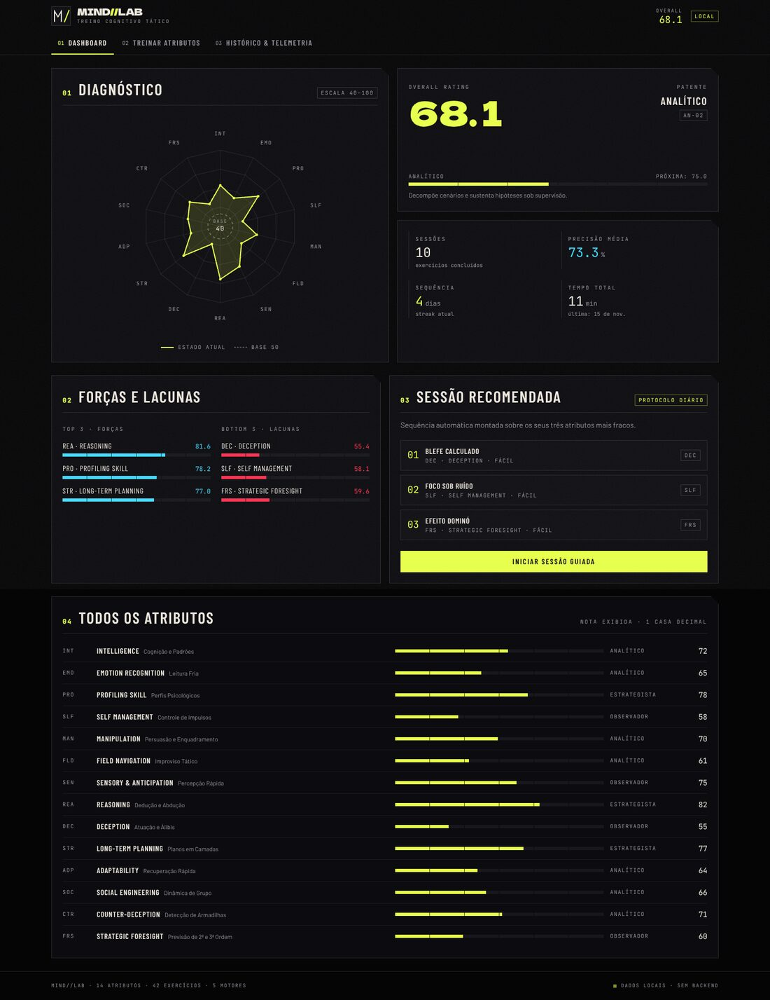

# MIND//LAB

Plataforma web interativa e gamificada de treinamento **cognitivo, psicológico e estratégico**,
inspirada na estética brutalista e na arquitetura de atributos de sistemas de criação de personagem
(estilo VS//EDIT).

Você começa com **50 pontos** (escala de 0 a 100) em **14 atributos mentais** e evolui cada nota
completando **42 exercícios** práticos divididos em três níveis de dificuldade. Não existe backend:
todo o progresso vive no `localStorage` do navegador.



> Stack: **React 19 · Vite 8 · TypeScript 7 · Tailwind CSS v4 · Vitest 5**

---

## Requisitos

- [Node.js](https://nodejs.org) `^20.19.0` ou `>=22.12.0`
- npm

## Como rodar

```bash
npm install
npm run dev
```

O servidor sobe em <http://localhost:5173>.

| Script               | O que faz                                                  |
| -------------------- | ---------------------------------------------------------- |
| `npm run dev`        | Servidor de desenvolvimento com HMR                         |
| `npm run build`      | Checa os tipos e gera o build de produção em `dist/`        |
| `npm run preview`    | Serve o build de produção localmente                        |
| `npm run lint`       | Oxlint (react, typescript e oxc)                            |
| `npm run typecheck`  | `tsc -b` sem emitir arquivos                                |
| `npm test`           | Vitest em modo run (19 testes)                              |
| `npm run test:watch` | Vitest em modo watch                                        |

---

## Deploy na Vercel

O projeto é 100% estático (SPA sem backend e sem variáveis de ambiente), então o deploy é direto.

### Pela interface

1. Abra <https://vercel.com/new> e conecte a conta do GitHub, se ainda não conectou.
2. Importe o repositório `yagosr47/mind-lab`.
3. A Vercel detecta o preset **Vite**. Confirme:
   - **Framework Preset**: Vite
   - **Install Command**: `npm ci`
   - **Build Command**: `npm run build`
   - **Output Directory**: `dist`
   - **Node.js Version**: 22.x (mínimo 20.19)
4. Clique em **Deploy**. Nenhuma env var é necessária.
5. Enquanto o PR não estiver mergeado, a produção sai do branch configurado em
   *Settings → Git → Production Branch*. Para publicar a versão do PR, use o deploy de preview.

O `vercel.json` versionado já fixa framework, comando de instalação, comando de build e diretório
de saída — a configuração no painel só precisa bater com ele.

### Preview automático por pull request

Depois da conexão, cada push gera uma URL de preview e cada PR recebe o link. O merge na `main`
atualiza a produção.

### Pela CLI

```bash
npm i -g vercel
vercel login
vercel          # deploy de preview
vercel --prod   # deploy de produção
```

### Detalhes que importam

- As fontes entram no bundle (subset latino), então não há dependência de CDN em runtime.
- O progresso vive no `localStorage`: preview e produção são domínios diferentes, logo têm dados
  separados. Use **Exportar JSON** / **Importar** na aba de telemetria para migrar.
- Não há rotas de servidor. As telas são navegação em memória, então não é necessário rewrite para
  `index.html`; se um dia entrar React Router, adicione o rewrite em `vercel.json`.
- `npm ci` exige o `package-lock.json`, que está versionado.

---

## Arquitetura

```
src/
├── types/
│   └── lab.ts                 # AttrKey, Difficulty, EngineType, Exercise, SessionRecord...
├── data/
│   ├── attributes.ts          # 14 atributos + benchmarks comparativos
│   ├── exercises.ts           # catálogo dos 42 exercícios e payloads por dificuldade
│   ├── cases.ts               # 10 dossiês do motor de auditoria de declarações
│   ├── scenarios.ts           # 14 cenários do motor tático (turnos e escolhas)
│   └── pools.ts               # pools de classificação rápida (microsinais, silogismos...)
├── lib/
│   ├── scoring.ts             # notas, retorno decrescente, patentes, médias
│   ├── storage.ts             # localStorage, streak, export/import/reset
│   ├── rng.ts                 # PRNG determinístico por sessão
│   ├── cx.ts                  # utilitário de classes
│   └── lab.test.ts            # testes unitários (vitest)
├── components/
│   ├── engines/               # os 5 motores jogáveis
│   ├── views/                 # Dashboard, Catalog, ExerciseArena, Debrief, Telemetry
│   ├── ui/                    # primitivas visuais + radar SVG
│   └── Logo.tsx
├── App.tsx                    # navegação, sessão ativa e persistência
├── index.css                  # @import tailwindcss + @theme (tokens)
└── main.tsx                   # fontes e montagem do React
```

### Convenções

- **Alias `@/`** aponta para `src/`. É definido em `tsconfig.app.json` (`paths`) e resolvido pelo
  Vite através de `resolve.tsconfigPaths`.
- **Tailwind CSS v4** é configurado no próprio CSS: não existe `tailwind.config.js`. Cores, fontes e
  animações vivem no bloco `@theme` de `src/index.css`.
- **Componentes de view** não calculam pontuação: recebem `LabProgress` e delegam a regra para
  `src/lib/scoring.ts`.

---

## Identidade visual

| Token              | Valor     | Uso                                        |
| ------------------ | --------- | ------------------------------------------ |
| `--color-ink`      | `#050506` | fundo principal                            |
| `--color-coal`     | `#0c0c10` | superfície de cards e modais                |
| `--color-ash`      | `#17171d` | bordas sutis e estados ativos               |
| `--color-bone`     | `#ece7dd` | texto principal                             |
| `--color-mute`     | `#93929a` | rótulos secundários e metadados             |
| `--color-tc`       | `#e6ff4a` | destaque, foco, XP e indicadores ativos     |
| `--color-hot`      | `#ff2e4d` | erro, pressão de tempo e dificuldade Difícil |
| `--color-cold`     | `#3fd9ff` | precisão, lógica e dificuldades Fácil/Médio |

Tipografia via `@fontsource` (apenas subset latino): **Dela Gothic One** (títulos e placares),
**Barlow Condensed** (rótulos, itálico pesado em destaques), **Barlow** (corpo) e
**JetBrains Mono** (métricas e coordenadas, com `tabular-nums`).

A atmosfera inclui granulação de filme (`opacity: 0.07`, via `feTurbulence`), bordas de 1px,
cantos chanfrados e as microanimações `slam`, `rise` e `blink` — todas desligadas em
`prefers-reduced-motion: reduce`.

---

## Os cinco motores

Cada exercício aponta para um motor que consome o `payload` da dificuldade selecionada.
Nada é quiz de múltipla escolha estático.

| Motor | Exercícios | O que mede | Escala |
| --- | --- | --- | --- |
| `stroop-reaction` | 6 | controle de impulso, atenção e velocidade sob interferência | 10 estímulos / 3.0s → 15 / 2.0s com regra invertida → 20 / 1.3s com ruído |
| `memory-matrix` | 6 | memória visual-espacial, sequência, N-Back e detecção de mudança | 3x3 / 4s → 4x4 / 2.5s → 5x5 / 1.5s |
| `rule-shift` | 6 | dedução de regra oculta (Wisconsin Card Sorting) | muda a cada 6 → 5 → 4 acertos (+ cartas ambíguas) |
| `statement-audit` | 10 | análise forense de texto: contradição, falácia, pista comportamental | 1 falha em 4 cláusulas → 2 em 6 → 2 em 8 com 45s e pistas falsas |
| `tactical-tree` | 14 | decisão em turnos com medidores de Suspeita e Vantagem | feedback total → 2ª ordem oculta → início em 50% de suspeita e meta de 85% |

### Detalhes rápidos

- **Stroop** aceita teclas `1–4`; nos níveis Médio/Difícil a regra pode inverter (responder a palavra
  em vez da tinta, ou o texto em vez da seta) e o HUD avisa qual regra vale.
- **Matriz** usa coordenadas alfanuméricas (A1, C4...), tem modo recordação, sequência, detecção de
  mudança e N-Back espacial. O modo Difícil adiciona alertas falsos.
- **Regra oculta** mostra apenas “combinou / não combinou”; a regra ativa nunca é revelada antes da
  troca. As cartas têm cor, forma e quantidade.
- **Auditoria** exige duas etapas: apontar as cláusulas e depois escolher o motivo técnico
  (30% da precisão). O modo Difícil tem cronômetro de 45s.
- **Tático** tem três turnos, medidores de 0 a 100 e um registro de consequências no fim.

---

## Catálogo: 14 atributos × 3 exercícios

| Código | Atributo | Domínio | Exercícios |
| --- | --- | --- | --- |
| `INT` | Intelligence | Cognição e Padrões | Matriz de Sequência Abstrata · Dual N-Back Espacial · Decodificador de Regras |
| `EMO` | Emotion Recognition | Leitura Fria | Incongruência Verbal · Triagem de Microsinais · Termômetro de Vulnerabilidade |
| `PRO` | Profiling Skill | Perfis Psicológicos | Autópsia de Ambiente · Assinatura Comportamental · Mapeamento de Alavancas |
| `SLF` | Self Management | Controle de Impulsos | Protocolo Stroop · Filtro de Provocação · Foco sob Ruído |
| `MAN` | Manipulation | Persuasão e Enquadramento | Arquitetura de Escolha · Detector de Viés · Negociação Assimétrica |
| `FLD` | Field Navigation | Improviso Tático | Recursos Escassos · Rota de Contingência · Virada de Mesa |
| `SEN` | Sensory & Anticipation | Percepção Rápida | Flash de Cena · Varredura Periférica · Leitura de Antecipação |
| `REA` | Reasoning | Dedução e Abdução | Eliminação de Hipóteses · Silogismo sob Pressão · Cadeia Causal |
| `DEC` | Deception | Atuação e Álibis | Sustentação de Álibi · Blefe Calculado · Blindagem de Narrativa |
| `STR` | Long-Term Planning | Planos em Camadas | Engenharia de Contingência · Posicionamento Silencioso · Auditoria de Ponto Cego |
| `ADP` | Adaptability | Recuperação Rápida | Mutação de Regras · Colapso do Plano A · Inversão de Comando |
| `SOC` | Social Engineering | Dinâmica de Grupo | Liderança por Procuração · Leitura de Hierarquia · Construção de Rapport |
| `CTR` | Counter-Deception | Detecção de Armadilhas | Interrogatório Cruzado · Desarme de Isca · Filtro de Blefe |
| `FRS` | Strategic Foresight | Previsão de 2ª e 3ª Ordem | Efeito Dominó · Árvore de Decisão · Cálculo de Consequência |

---

## Progressão e pontuação

Todos os atributos começam em **50.0** e ficam sempre dentro de **[40, 100]**. A nota aparece
arredondada no radar e com uma casa decimal na ficha detalhada.

```text
ganho = (xp / 15) × (precisão / 100)^1.4 × fatorRetorno(nota)
fatorRetorno(nota) = clamp(((100 − nota) / 50)^0.9, 0.08, 1)
```

- `xp` é a recompensa do nível: **Fácil 15**, **Médio 30**, **Difícil 55**.
- Quanto maior a nota, menor o ganho — chegar de 50 a 60 é rápido; de 90 a 95 exige consistência.
- **Precisão < 50%**: não há ganho no Fácil/Médio e há **−0.3** no Difícil (falha crítica).
- O piso de 40 nunca é ultrapassado, nem com falhas repetidas.

### Patentes por faixa de nota

| Faixa | Patente |
| --- | --- |
| 0–59 | Observador |
| 60–74 | Analítico |
| 75–84 | Estrategista |
| 85–92 | Mestre Tático |
| 93–100 | Nível Gênio |

### Benchmark comparativo

A ficha de cada atributo compara a nota do usuário com arquétipos de referência — por exemplo
**80 = Investigador Veterano**, **90 = Mestre de Xadrez / Perfilador Clínico** e
**96 = Pico de Ficção**. Cada atributo tem quatro referências próprias.

---

## Telas

1. **Dashboard** — radar SVG de 14 eixos (escala 40–100) com polígono atual em `#e6ff4a` e a linha
   fantasma tracejada da base 50; top 3 forças (ciano) e bottom 3 lacunas (vermelho); protocolo diário
   automático com os três atributos mais fracos e botão “Iniciar sessão guiada”; métricas de overall,
   sessões, precisão média e streak.
2. **Catálogo** — filtro por texto, motor e patente; grid dos 14 atributos; gaveta lateral com nota,
   benchmarks e os três exercícios, cada um com seleção de Fácil/Médio/Difícil antes de iniciar.
3. **Arena** — briefing, cronômetro regressivo (vermelho nos últimos 5s), botão de aborto com
   confirmação e o motor em tela cheia. Depois vem o **debriefing** com precisão, tempo, ganho,
   análise cognitiva e aplicação prática.
4. **Histórico & telemetria** — sessões cronológicas com filtro por atributo, exportação/importação em
   JSON e reset com confirmação.

---

## Persistência

- Chave: `mindlab:progress:v1` no `localStorage`.
- Estrutura: notas por atributo, sessões (máx. 500), sequência de dias e data da última sessão.
- **Streak** sobe quando há sessão em dias consecutivos; duas sessões no mesmo dia contam uma vez.
- Qualquer JSON exportado pode ser reimportado; notas fora da faixa são normalizadas e registros
  inválidos são descartados.
- Como tudo é local, limpar os dados do navegador apaga o progresso — exporte antes.

---

## Testes

```bash
npm test
```

A suíte (`src/lib/lab.test.ts`, 19 casos) verifica, entre outras coisas:

1. **Catálogo completo** — 14 atributos, exatamente 3 exercícios válidos para cada, ids únicos e os
   cinco motores representados.
2. **Três dificuldades por exercício** — `easy`, `medium` e `hard` sempre presentes, com rótulos, XP,
   cronômetro e payload coerentes; payloads de auditoria e cenários táticos batem com os dossiês.
3. **Fórmula de pontuação** — limites `[40, 100]`, retorno decrescente comprovado (nota 52 rende mais
   que 92), zero ganho abaixo de 50% de precisão, −0.3 no Difícil e piso/teto respeitados em sessões
   repetidas.

Também cobre patentes, persistência (sessão, streak, export/import, normalização) e a integridade dos
10 dossiês e 14 cenários.

---

## Decisões técnicas

- **Vite 8** resolve o alias do TypeScript nativamente (`resolve.tsconfigPaths`), sem
  `vite-tsconfig-paths`.
- **Tailwind v4** lê o tema do CSS; os utilitários `bg-ink`, `text-tc`, `font-condensed` etc. nascem
  dos tokens declarados em `@theme`.
- **Fontes** são importadas apenas no subset latino para manter o CSS final abaixo de 40 kB.
- **PRNG determinístico** (`mulberry32`, semente por sessão) em vez de `Math.random()` durante o
  render: o React Compiler considera a função impura e a sequência precisa ser estável na montagem.
- **Sem backend**: exportar/importar JSON é a única forma de transporte de progresso.
- Acessibilidade: foco visível, rótulos ARIA nos controles de jogo, navegação por teclado (`1–4` no
  Stroop) e animações respeitando `prefers-reduced-motion`.
